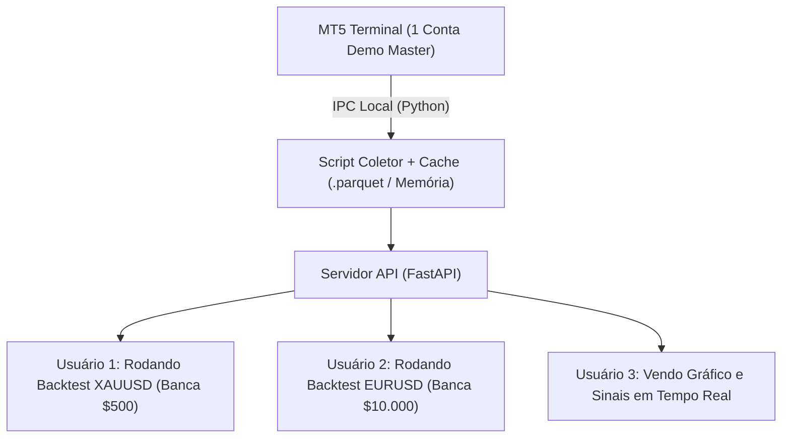

# Guia de Integração de Backtestes (`backeteste.md`)

Este documento detalha o plano de ação para estruturar e integrar um motor de **Backtest** eficiente no sistema de trading, abordando desde a obtenção e limpeza de dados históricos de mercado até a escolha da arquitetura mais prática para validação e execução de estratégias.

---

## 1. O Que Devemos Fazer (Plano de Integração)

Para integrar o backteste de forma sólida e evitar que o código de simulação fique desconectado do robô de execução real (*live trading*), devemos seguir 4 etapas principais:

1. **Desacoplar a Estratégia da Execução:** A lógica que gera sinais (`COMPRA`, `VENDA`, `NEUTRO`) deve receber apenas dados padronizados (candles/indicadores) e retornar intenções de ordem, sem saber se está rodando em um backteste ou na corretora real.
2. **Camada de Dados Unificada (Data Feed):** Criar um módulo que baixe dados históricos e os salve localmente (em `.parquet` ou `.csv` / banco SQLite) no mesmo formato que o robô recebe em tempo real.
3. **Simulador de Execução Realista:** Desenvolver ou integrar um motor que contabilize **custos operacionais reais**:
   - *Spread* (diferença entre Bid e Ask)
   - Taxas/Comissões da corretora ou exchange
   - *Slippage* (derrapagem de preço na execução a mercado)
4. **Relatório de Métricas Padronizado:** Avaliar cada teste não apenas pelo lucro líquido, mas por métricas ajustadas ao risco (Drawdown Máximo, Sharpe Ratio, Profit Factor, Taxa de Acerto e Expectativa Matemática).

---

## 2. Como Obter os Dados do Mercado

A qualidade do backteste depende 100% da qualidade dos dados históricos (**OHLCV** - *Open, High, Low, Close, Volume* ou dados *Tick-by-Tick*). Abaixo estão as fontes mais práticas conforme o mercado operado:

### A. Forex, Índices, Commodities e B3 (via MetaTrader 5)
- **Como funciona:** A biblioteca oficial `MetaTrader5` para Python permite extrair anos de histórico de barras (M1, M5, H1, D1) e até *ticks* diretamente do servidor da sua corretora.
- **Vantagem:** Os dados refletem exatamente o ativo, o *spread* e o fuso horário onde o seu robô vai operar.
- **Exemplo prático (`mt5.copy_rates_from_pos`):** Extrai candles diretamente para um `pandas.DataFrame`.

> **Dúvida Comum: Preciso da API do TradingView ou o próprio MT5 já resolve tudo?**
> **O próprio MT5 já completa 100% do requisito — você NÃO precisa da API do TradingView.**
> - **Motivo 1 (Acesso e Custo):** O TradingView não fornece uma API pública/barata para baixar dados históricos em Python (as bibliotecas não-oficiais quebram com frequência e têm limite curto de velas). Já o pacote oficial `MetaTrader5` em Python é **100% gratuito, oficial e sem limites de requisição**.
> - **Motivo 2 (Fidelidade de Preço e Spread):** No TradingView, o gráfico muitas vezes vem de outro provedor (ex.: OANDA, FXCM, ICE), com preços e *spreads* diferentes da corretora onde seu dinheiro está. Pelo MT5, você baixa os **candles e o spread exatos da sua corretora**, garantindo que o backteste bata perfeitamente com a conta real.
> - **Motivo 3 (Histórico Completo + Ticks Reais):** O MT5 entrega tanto as velas prontas (`OHLCV` + `spread` de cada vela) quanto todos os *ticks* reais (`bid`/`ask` milissegundo a milissegundo) gratuitamente.
> - **Quando o TradingView seria útil?** Apenas se você já tivesse um indicador fechado em *Pine Script* que não quisesse traduzir para Python (enviando alertas via Webhook), ou apenas para visualização manual na tela. Para alimentar seu backteste e seu robô em Python, **o MT5 sozinho é muito superior**.

### B. Criptomoedas (Binance, Bybit, OKX via CCXT)
- **Como funciona:** A biblioteca `ccxt` unifica mais de 100 exchanges e permite baixar dados históricos via método `fetch_ohlcv(symbol, timeframe, since, limit)`. Para históricos massivos (anos de M1), a Binance também disponibiliza arquivos mensais gratuitos no portal *Binance Data Collection* (`data.binance.vision`).
- **Vantagem:** Gratuito, sem necessidade de conta paga e com altíssima precisão.

### C. Ações Globais, ETFs e Índices (Yahoo Finance / `yfinance`)
- **Como funciona:** Biblioteca Python `yfinance` gratuita para baixar dados diários e intradiários.
- **Limitação:** Dados de 1 minuto (`1m`) são limitados aos últimos 7 a 30 dias; dados de 1 hora (`1h`) até 730 dias. Excelente para prototipagem rápida e *Swing Trade*, mas limitado para *Scalping* longo.

### D. Dados Históricos de Alta Precisão (Dukascopy / Polygon.io / Databento)
- **Como funciona:** O **Dukascopy** oferece dados *tick-by-tick* gratuitos de Forex, Ouro (XAUUSD) e Índices com mais de 10 anos de histórico (acessíveis via pacotes como `dukascopy-node` ou `tickterial`).

> **Boas Práticas de Armazenamento:**
> Nunca baixe os dados da internet toda vez que rodar um backteste. Baixe uma única vez e salve localmente em formato **Apache Parquet (`.parquet`)** ou **SQLite**. O formato `.parquet` é até 10x mais rápido para ler no Python (`pandas.read_parquet`) e ocupa uma fração do espaço de um `.csv`.

---

## 3. Os Diferentes Modelos de Backteste

Existem três arquiteturas principais para construir ou escolher um motor de backteste. Cada uma tem um equilíbrio diferente entre **velocidade** e **fidelidade ao mundo real**:

### Modelo 1: Backteste Vetorizado (Vectorized Backtesting)
Calcula todos os indicadores e sinais de compra/venda de uma só vez usando operações matriciais em colunas inteiras (`pandas` / `numpy`), sem usar laços de repetição (`for`).
- **Ferramentas principais:** `Pandas` puro, `VectorBT`.
- **Prós:** Extremamente rápido (testa milhares de combinações de parâmetros em segundos).
- **Contras:** Maior risco de *Look-ahead Bias* (usar dados do futuro sem querer) e mais difícil de simular gerenciamento de risco complexo (ex.: *Trailing Stop* dinâmico intrabarra ou múltiplas ordens parciais).

### Modelo 2: Backteste Orientado a Eventos — Barra a Barra (Bar-by-Bar Event-Driven)
O sistema percorre o histórico em um loop cronológico vela por vela (`for candle in historico:`). A cada fechamento de barra, a estratégia recebe apenas os dados até aquele instante e decide o que fazer.
- **Ferramentas principais:** `Backtesting.py`, `Backtrader`, ou um motor próprio (*Custom Loop*).
- **Prós:** Muito fiel à vida real; elimina quase totalmente o risco de olhar o futuro; fácil de embutir regras de *Stop Loss*, *Take Profit*, *Break-even* e *Trailing Stop*; permite reutilizar a **mesma classe Python** no robô ao vivo.
- **Contras:** Mais lento que o vetorizado para otimizações gigantescas, e não sabe a ordem exata do que aconteceu *dentro* do candle (se bateu na máxima ou na mínima primeiro, a menos que use candles menores).

### Modelo 3: Backteste Tick-a-Tick / Livro de Ofertas (Tick-Level & Order Book)
Reproduz cada negócio individual (*tick*) e a fila do livro de ofertas (*Level 2 / DOM*).
- **Ferramentas principais:** `NautilusTrader`, testador nativo do `MetaTrader 5` (modo *Every Tick based on real ticks*).
- **Prós:** Precisão cirúrgica. Indispensável para *High-Frequency Trading (HFT)*, *Market Making* ou *Scalping* de segundos.
- **Contras:** Arquivos de dados gigantescos (dezenas de GBs), execução lenta e alta complexidade de código.

### Quadro Comparativo

| Característica | 1. Vetorizado | 2. Barra a Barra (Event-Driven) | 3. Tick-a-Tick |
| :--- | :---: | :---: | :---: |
| **Velocidade de Execução** | Ultra-rápida (ms) | Rápida / Média (segundos) | Lenta (minutos) |
| **Facilidade de Implementação** | Alta | Alta | Baixa (Complexa) |
| **Fidelidade (Stop/Trailing)** | Média | Alta | Altíssima |
| **Reuso de Código no Live Bot** | Baixo | **Muito Alto (1:1)** | Alto |
| **Ideal para** | Pesquisa e Otimização | **Day Trade e Swing Trade** | Scalping extremo / HFT |

---

## 4. Qual é o Modelo Mais Prático? (Recomendação)

Para **95% dos projetos de trading algorítmico (Day Trade em M1/M5/M15 ou Swing Trade)**, a abordagem mais prática, segura e produtiva é o **Modelo 2 (Event-Driven Barra a Barra)** combinado com uma etapa inicial rápida ou usando a biblioteca **`Backtesting.py`** / **Motor Próprio Híbrido**.

### Por que essa é a escolha mais prática?

1. **Mesmo Código no Backteste e na Conta Real:**
   Se criarmos um motor *Barra a Barra* limpo (ou usarmos uma interface padrão `on_bar(candle)`), a função que analisa o mercado no backteste será **exatamente a mesma** chamada pelo loop ao vivo do robô. Você não precisa programar a estratégia duas vezes.
2. **Simulação Realista de Stops Intrabarra:**
   A cada novo candle, o motor verifica primeiro se a ` mínima (Low)` ou `máxima (High)` daquele candle atingiu o *Stop Loss* ou *Take Profit* da posição aberta (adicionando uma regra conservadora: se o mesmo candle tocar no Stop e no Gain, assume-se que deu **Stop Loss**, protegendo sua estatística contra otimismo falso).
3. **Ecossistema Prático em Python:**
   - **Para começar hoje com gráficos interativos prontos:** Usar a biblioteca **`backtesting.py`** (leve, aceita indicadores do `pandas-ta` / `TA-Lib`, gera relatório completo em HTML interativo com apenas 20 linhas de código).
   - **Para integração total com o seu próprio Bot:** Criar uma classe `BacktestEngine` enxuta (~150 linhas de Python) que lê um arquivo `.parquet`, pré-calcula os indicadores de forma vetorizada (ganhando a velocidade do Modelo 1) e percorre os sinais barra a barra gerenciando banca, taxas, *Stop Loss* e *Take Profit* (ganhando a precisão do Modelo 2).

---

## 5. Arquitetura Recomendada para Implementarmos no Projeto

Sugiro estruturarmos uma pasta `backtest/` no projeto com apenas 4 arquivos objetivos:

```text
TRADING COSSA/
├── data/
│   └── historical/          # Arquivos .parquet / .csv baixados (ex: EURUSD_M5.parquet)
├── backtest/
│   ├── data_loader.py       # Script para baixar dados (MT5 / CCXT / Yahoo) e salvar no disco
│   ├── engine.py            # Motor de simulação (saldo, taxas, stop loss, take profit)
│   ├── metrics.py           # Cálculo de Winrate, Profit Factor, Drawdown, Sharpe Ratio
│   └── run_backtest.py      # Script principal para rodar testes e gerar o gráfico de curva de capital
└── strategies/
    └── base_strategy.py     # Estratégia compartilhada entre o Backtest e o Robô Live
```

### Próximo Passo Sugerido
Se estiver de acordo com essa estrutura, podemos:
1. Definir qual é a **fonte de dados principal** que você está operando (ex.: MetaTrader 5, Binance/Cripto, Quotex/Opções ou B3).
2. Criar imediatamente o `data_loader.py` e o `engine.py` prontos para rodar o primeiro backteste da sua estratégia atual.

---

## 6. Como Funciona a Comunicação com o MT5 (Infraestrutura e Requisitos)

A biblioteca oficial `MetaTrader5` do Python **não se conecta direto aos servidores da corretora pela internet**; ela se comunica via **IPC (Inter-Process Communication)** diretamente com o programa **Terminal MetaTrader 5** aberto na mesma máquina.

Por isso, os requisitos mudam dependendo se você está apenas **rodando Backtestes** ou **operando em Conta Real/Demo 24/7**:

### Cenário A: Apenas para Backteste (Zero Custo de Servidor)
- **Onde roda:** No seu próprio computador pessoal (Windows) — ou até em Linux/Mac depois que os dados já foram salvos.
- **O que precisa:**
  1. Ter o programa **MetaTrader 5** instalado e logado em uma conta (pode ser uma conta **Demo gratuita** de qualquer corretora, como Exness, FTMO, XM, XP, etc.).
  2. Rodar o script `data_loader.py` **uma única vez** com o MT5 aberto para baixar o histórico e salvar em arquivos `.parquet` no projeto.
  3. **Depois que o arquivo `.parquet` está salvo:** Você pode até **fechar o MT5**! O motor de backteste em Python lê os arquivos do disco e roda 100% *offline*, em qualquer sistema operacional.

### Cenário B: Para Operar ao Vivo 24/7 ou Alimentar um Sistema Web (Produção)
Se o robô precisar puxar velas em tempo real e enviar ordens 24 horas por dia sem você deixar seu PC ligado em casa:

- **O que é necessário:**
  1. **VPS Windows (Windows Server 2019/2022 ou Windows 10/11):** Como a biblioteca oficial `MetaTrader5` para Python só funciona nativamente no Windows, uma VPS Windows básica (2 vCPU, 2 GB a 4 GB de RAM — custa entre $5 e $12/mês em provedores como Contabo, Hetzner, AWS Lightsail ou Vultr) é o padrão mais estável.
  2. **Terminal MT5 instalado e aberto na VPS:** Logado na conta da corretora e com a opção **"Permitir negociação algorítmica" (Algo Trading)** ativada em *Ferramentas > Opções > Expert Advisors*.
  3. **Python 3.10+ (64-bit) instalado na mesma VPS:** Com os pacotes `MetaTrader5`, `pandas`, `numpy` (e `fastapi`/`uvicorn` se você quiser expor uma API para um painel Web).

### Arquitetura caso você tenha um Painel Web / SaaS em outro servidor (Linux)
Se o seu site/painel estiver hospedado em um servidor Linux (Vercel, Railway, Render, VPS Ubuntu):
```text
[Seu Painel Web / Backend]  <--- (HTTP REST / WebSocket) --->  [VPS Windows: API FastAPI + Python + MT5 Aberto]
```
Nessa estrutura, criamos uma pequena **ponte em FastAPI** rodando junto com o MT5 na VPS Windows. Assim, qualquer sistema seu (em qualquer lugar) consegue pedir históricos, rodar backtestes ou disparar ordens no MT5 via simples chamadas HTTP!

---

## 7. Arquitetura Multi-Usuário (Vários Usuários Fazendo Backteste e Acessando Contas)

Se o objetivo é ter uma plataforma onde **vários usuários** entram ao mesmo tempo para rodar backtestes e acessar dados em tempo real, existe uma regra de ouro sobre o funcionamento do MT5:

> **Regra Técnica do MT5:** Um programa MetaTrader 5 aberto só consegue manter **1 única conta logada por vez**. Se você chamar `mt5.login(conta_usuario_2)` no mesmo terminal, ele desconecta o `usuario_1`.

Por isso, a arquitetura profissional e mais econômica divide **Dados de Mercado (Backteste)** de **Conta Individual do Usuário**:

### 1. Para o Backteste e Preços em Tempo Real (1 Conta Demo "Master" serve para TODOS)
Os candles de `EURUSD`, `XAUUSD`, `NAS100`, etc., são iguais para todos os usuários.
- **Como funciona:** Você deixa **apenas 1 MT5 aberto na VPS logado em uma Conta Demo sua (Conta Master)**.
- **Fluxo:** Esse script Python puxa os dados em tempo real e mantém o histórico atualizado no servidor.
- **Resultado:** Quando 50 ou 500 usuários entrarem na plataforma para fazer backteste ao mesmo tempo, **todos eles usam os dados dessa Conta Demo Master**, mas cada usuário passa seus próprios parâmetros (ex: *Banca de $1.000, Stop de 200 pts, Lote 0.10*) e o Python calcula o resultado individual de cada um em milissegundos!

### 2. E quando cada usuário quiser conectar a SUA PRÓPRIA conta do MT5?
Existem **3 caminhos práticos** dependendo do que você quer permitir que o usuário faça na conta dele:

| Abordagem | Como funciona | Quantos usuários suporta? | Melhor para... |
| :--- | :--- | :--- | :--- |
| **A. Conta Simulada na Plataforma (Paper Trading + Backtest)** | O MT5 Demo Master fornece apenas a cotação ao vivo. O saldo, ordens simuladas e backtestes de cada usuário ficam no **Banco de Dados do seu sistema**. | **Ilimitado** (Milhares de usuários com 1 único MT5) | Plataformas de Backtest, Replay de Mercado e Simulador. |
| **B. Ver Saldo/Histórico da Conta Real do Usuário (Login Sob Demanda / Fila Rápida ou Multi-Terminal)** | Um terminal MT5 secundário faz login rápido (`mt5.login(login, senha, servidor)`), sincroniza o saldo/histórico do usuário para o seu banco de dados em 1 segundo e libera a fila, **ou** abre instâncias `--portable` separadas. | **10 a 30 contas simultâneas** por VPS (em instâncias separadas) ou centenas via sincronização rápida. | Dashboards de análise de conta e Copy Trading para grupos fechados. |
| **C. Conector EA no MT5 do Usuário ou API Cloud (MetaApi)** | O usuário baixa um mini-Conector (Expert Advisor) no MT5 dele que envia os dados para a sua API Web, **ou** você usa uma API de nuvem (como `MetaApi.cloud`). | **Ilimitado** | SaaS grande onde cada cliente opera na sua própria corretora 24/7. |

### Arquitetura Recomendada para Começarmos Agora (Mais Prática e Custo Zero)



Com esse desenho acima:
1. Você usa **apenas 1 conta Demo no MT5** para puxar tudo em tempo real.
2. Qualquer usuário logado no seu sistema faz backtestes personalizados instantaneamente sem travar o MT5 dos outros.

---

## 8. MT5 vs. TradingView: Onde entra a Fibonacci e as Ferramentas Gráficas?

Existe uma diferença essencial entre **1) A Interface Visual na Tela (Gráfico onde o usuário desenha)** e **2) A Fonte de Dados + Cálculo Matemático no Servidor**:

### 1. Na Matemática (Backteste Automático): A Eficiência é 100% Igual
Ferramentas como **Retração/Extensão de Fibonacci** (`0.236`, `0.382`, `0.500`, `0.618`, `0.786`), **Ondas de Elliott**, **Smart Money (Order Blocks, FVG)**, **RSI** e **Médias Móveis** são puras fórmulas matemáticas calculadas sobre a Máxima (`High`), Mínima (`Low`) e Fechamento (`Close`) das velas.
- No **Python + MT5**, nós programamos o detector de *Swing High* (Topo) e *Swing Low* (Fundo) e calculamos a Fibonacci exata em milissegundos, inclusive com mais precisão que o TradingView porque usamos o preço real e o *spread* da corretora.

### 2. No Visual para o Usuário Desenhar na Tela: O Estilo TradingView é Muito Melhor!
A interface antiga do programa MetaTrader 5 realmente é ruim e travada para desenhar Fibonacci, medir Risco/Retorno (*Long/Short Position*) e arrastar linhas no navegador.
- **Como as grandes plataformas (como *FXReplay*, *TradeZella* e corretoras modernas) resolvem isso?**
  Elas combinam **o melhor dos dois mundos**:
  1. **Por trás (Backend):** O Python puxa os dados em tempo real gratuitamente da **Conta Demo do MT5**.
  2. **Na frente (Tela Web do Usuário):** O site exibe o gráfico usando a biblioteca visual **`TradingView Lightweight Charts`** (que é **gratuita e open-source**, criada pelo próprio TradingView!) ou um canvas interativo com ferramentas de desenho (Fibonacci, Regra de Risco/Ganho, Linha de Tendência, Botão de "Avançar 1 Vela / Replay").

### Resumo: O Segredo das Plataformas de Backtest (Estilo FXReplay)

| Camada do Sistema | O que usar? | Por quê? |
| :--- | :--- | :--- |
| **Fonte de Dados (Velas e Preço Vivo)** | **MetaTrader 5 (Python)** | Gratuito, sem limite de histórico, preço e spread reais da corretora. |
| **Gráfico na Tela do Usuário (Frontend)** | **TradingView Lightweight Charts + Ferramentas de Desenho** | Visual moderno e fluido idêntico ao TradingView, rodando direto no navegador do seu cliente. |
| **Cálculo de Fibonacci / Indicadores** | **Python (Automático) + Desenho no Gráfico (Manual)** | Permite tanto o backteste 100% automático (robô) quanto o backteste manual (*Replay de Mercado* onde o usuário traça a Fibonacci na tela). |

---

## 9. Repositórios Prontos (Open-Source) que Sincronizam MT5 com Visual TradingView

Você **não precisa construir o gráfico nem as ferramentas de Fibonacci do zero**. Existem repositórios prontos e gratuitos no GitHub que já trazem toda a interface visual (barra lateral de desenhos, Fibonacci, indicadores, seletor de timeframe) e recebem os dados diretamente do Python + MT5:

### Opção 1: `KLineChart Pro` (O Melhor Clone Web Completo do TradingView)
- **Repositório:** `github.com/klinecharts/pro` (`npm install @klinecharts/pro klinecharts`)
- **O que já vem 100% pronto nele:**
  - Barra lateral de ferramentas idêntica ao TradingView (**Retração de Fibonacci**, Extensão/Canal de Fibonacci, Ondas de Elliott, Caixa de Gann, Linhas de Tendência, Paralelas, Régua);
  - Mais de **25 indicadores prontos** na tela (RSI, MACD, Médias Móveis, Bandas de Bollinger, Volume, etc.);
  - Barra superior com troca de Ativo (`XAUUSD`, `EURUSD`), troca de Timeframe (`M1`, `M5`, `M15`, `H1`, `D1`), Modo Escuro/Claro e botão de Foto;
- **Como sincroniza com o MT5:** Possui uma interface `datafeed` simples onde você aponta para o seu endpoint Python (`GET /api/history` e `WebSocket /ws/ticks`) que lê o MT5.

### Opção 2: `lightweight-charts-python` (Pronto direto em Python + Web)
- **Repositório:** `github.com/louisnw01/lightweight-charts-python` (`pip install lightweight-charts`)
- **O que já vem pronto nele:**
  - Empacota o gráfico oficial do TradingView (`Lightweight Charts`) diretamente para Python;
  - Já inclui uma `ToolBox` nativa com **Retração de Fibonacci**, Linha de Tendência, Raio e Linha Horizontal (que salvam os desenhos automaticamente);
  - Aceita o `DataFrame` que sai do `MetaTrader5` diretamente com 1 linha de código (`chart.set(df)`) e sincroniza *ticks* em tempo real com `chart.update_from_tick()`.

### Opção 3: `TradingView Charting Library` Oficial + Conector `UDF` Python
- **Como funciona:** É a biblioteca completa oficial do TradingView (a mesma que aparece dentro do app da Binance e da Bybit).
- **Como sincroniza com o MT5:** Ela usa um protocolo padrão chamado **UDF (Universal Data Feed)**. Basta criar 4 rotas padrões no FastAPI (`/config`, `/symbols`, `/history`, `/time`) lendo do MT5, e o gráfico completo do TradingView sincroniza sozinho! *(Requer solicitar acesso gratuito ao repositório privado do TradingView usando e-mail de domínio próprio, enquanto as Opções 1 e 2 são 100% abertas para baixar na hora).*

### Comparativo Rápido: Qual usar para não programar do zero?

| Repositório | Tem Fibonacci e Barra de Desenho Pronta? | Tem Indicadores Prontos na Tela? | Ideal para... |
| :--- | :---: | :---: | :--- |
| **`KLineChart Pro`** | **Sim (Completa: Fib, Elliott, Gann, Linhas)** | **Sim (+25 indicadores)** | **Plataforma Web Multi-Usuário (SaaS)** |
| **`lightweight-charts-python`** | **Sim (Fib, Tendência, Horizontal)** | Via Python (`pandas`) | **Integração ultra-rápida direto em Python** |
| **`TradingView Charting Library (UDF)`** | **Sim (100% igual ao TradingView.com)** | **Sim (+100 indicadores)** | **Corretoras/Apps com licença aprovada pelo TV** |

---

## 10. Implementação Realizada no Projeto (`KLineChart Pro` + Multi-API)

A integração do **KLineChart Pro** foi implementada e já está disponível na página de **Backtest (`/backtest`)**:

1. **Repositório Clonado na Raiz:**
   - Pasta [`klinecharts-pro/`](file:///e:/TRADING%20COSSA/klinecharts-pro) com todo o código-fonte original caso deseje customizar componentes internos em SolidJS/TypeScript.
   - Pacotes `klinecharts` e `@klinecharts/pro` instalados diretamente no frontend React ([`client/package.json`](file:///e:/TRADING%20COSSA/client/package.json)).

2. **Adaptador Multi-API (`CustomKLineDatafeed`):**
   - Arquivo: [`client/src/services/klineDatafeed.ts`](file:///e:/TRADING%20COSSA/client/src/services/klineDatafeed.ts)
   - Permite alternar em tempo real com 1 clique entre **3 fontes de dados**:
     - **`TradingView API`:** Consome o módulo [`TradingViewService`](file:///e:/TRADING%20COSSA/backend-nest/src/tradingview/tradingview.service.ts) (`@mathieuc/tradingview`) no backend NestJS (`/api/tradingview/candles` e `/api/tradingview/search`).
     - **`Binance Real-Time (WS)`:** Consome velas históricas e WebSocket em tempo real direto da Binance (`BTCUSD`, `ETHUSD`, Ouro via `PAXGUSDT`, `EURUSDT`, `GBPUSDT`).
     - **`MT5 / Oanda Feed`:** Consome o endpoint `/api/market-data/candles` do backend.
     - **Fallback Institucional Garantido:** Caso o backend esteja offline ou sem internet, gera séries determinísticas realistas para que o gráfico nunca fique em branco.

3. **Terminal Gráfico + Replay de Velas + Boleta de Execução (`KLineChartProTerminal`):**
   - Arquivo: [`client/src/components/KLineChartProTerminal.tsx`](file:///e:/TRADING%20COSSA/client/src/components/KLineChartProTerminal.tsx)
   - **Tradução Completa (`pt-BR`):** Todas as ferramentas de Fibonacci (Retração, Extensão, Espiral, Círculo, Leque), Caixa de Gann, Ondas de Elliott (3, 5, 8), Padrões Harmônicos (ABCD, XABCD) e +25 indicadores traduzidos para português.
   - **Modo Replay Vela-a-Vela:** Permite cortar o histórico, avançar `+1 Vela` manualmente ou dar `Auto Play` (`1x`, `2x`, `5x`).
   - **Boleta de Compra/Venda com Stop Loss e Take Profit Automáticos:** Executa ordens no preço da vela atual, verifica intrabarra (`High`/`Low`) se atingiu o *Stop Loss* ou *Take Profit* a cada vela avançada e salva a sessão no histórico de backtest da conta.

---

## 11. Sugestões e Recomendações de Stacks e Frameworks (Nível SaaS Profissional)

Para escalar a plataforma no mesmo nível de fluidez e velocidade do **Traynio**, **FXReplay** e **TradeZella**, abaixo estão as melhores escolhas de tecnologias para cada camada:

### 1. Gerenciamento de Estado de Alta Frequência no Frontend (React)
- **Recomendado:** **`Zustand`** (com seletores atômicos e `subscribeWithSelector`).
- **Por quê?** No React puro (`useState` / `useContext`), atualizar preços tick-a-tick ou avançar velas rápido pode disparar re-renderizações em cascata. Com o **Zustand**, cada camada (Boleta, Rodapé de Posições, Barra Flutuante) escuta **apenas o campo exato** que precisa (ex.: `useReplayStore(s => s.openPositions.length)`), mantendo 60 FPS mesmo em velocidades de Replay de `10x` ou `50x`.

### 2. Processamento Pesado no Navegador sem Travar a Tela
- **Recomendado:** **`Web Workers` (via `Comlink`) + `IndexedDB` (`Dexie.js`)**.
- **Por quê?**
  - **Dexie.js (IndexedDB):** Permite salvar 50.000 a 200.000 velas de `XAUUSD` ou `EURUSD` direto no navegador do usuário. Quando o usuário troca de `15m` para `1h` ou volta no tempo, a troca é **instantânea (0 ms de rede)**.
  - **Web Worker:** Calcula indicadores pesados (SMC, Order Blocks, perfil de volume, estatísticas de Drawdown/Sharpe Ratio) em uma thread separada sem nunca congelar o mouse no gráfico.

### 3. Motor de Gráficos e Multi-Telas (Layout 2x2 / Sincronizado)
- **Recomendado:** **`KLineCharts v9/v10` (Canvas 2D)** + **`TradingView Lightweight Charts`** (para mini-curvas de capital).
- **Para Multi-Gráficos (`Sync` entre M5 e H1 na mesma tela):** Usar **`react-resizable-panels`** (mesma biblioteca usada pelo VS Code Web e Linear) para dividir a tela em 2 ou 4 gráficos redimensionáveis sincronizados pelo timestamp do Replay.

### 4. Backend e Banco de Dados para Séries Temporais (Candles & Ticks)
Você já possui uma base excelente no [`backend-nest`](file:///e:/TRADING%20COSSA/backend-nest/package.json) (`NestJS` + `Fastify` + `ClickHouse` + `Redis` + `PostgreSQL`). A recomendação de uso ideal para cada banco que já está no seu projeto é:
- **`ClickHouse` (ou `TimescaleDB`):** Guardar os milhões de candles históricos (M1, M5, M15, H1) de todos os pares. O ClickHouse comprime séries financeiras em até 90% e entrega 100.000 velas em menos de **15 milissegundos**.
- **`PostgreSQL` (via `TypeORM`):** Guardar dados relacionais (Usuários, Assinaturas, Contas, Sessões de Backtest Salvas, Diário/Journal e Desenhos de Fibonacci salvos em JSON).
- **`Redis`:** Cache das últimas 1.000 velas dos pares mais acessados (`XAUUSD`, `EURUSD`, `BTCUSD`) para resposta imediata.

### 5. Provedores de Dados de Mercado (Market Data Feeds) para Produção
Quando quiser histórico profundo (5 a 15 anos de M1 para planos pagos, igual ao aviso *"A paid plan unlocks the full history"* da imagem do Traynio):
1. **Dukascopy Historical Feed (`dukascopy-node`)** — **100% Gratuito**, oficial de banco suíço, com mais de 15 anos de histórico M1 e Tick-a-Tick de Forex, `XAUUSD`, Índices (`NAS100`, `US30`) e Cripto. Pode rodar via script no seu próprio `backend-nest` para popular o seu ClickHouse/PostgreSQL!
2. **Polygon.io / TwelveData / Finnhub** — Excelentes APIs comerciais REST/WebSocket caso queira suporte oficial multi-bolsas sem manter coletor próprio.
3. **Worker Python + MetaTrader 5 (FastAPI + gRPC/Redis)** — Ideal para sincronizar contas reais de clientes e puxar cotações ao vivo de corretoras específicas.


