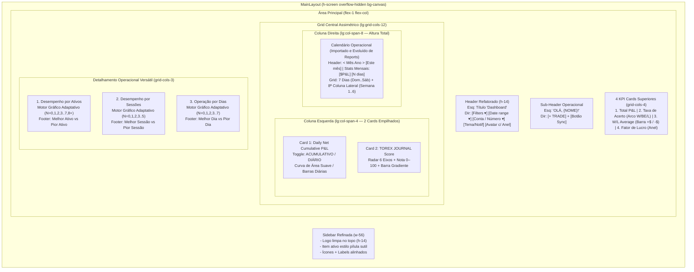

# Plano de Refatoração do Dashboard, Header e Sidebar (`dahboardrefactor.md`)

Este documento define a arquitetura, especificação visual, regras de adaptação de gráficos e etapas de implementação para refatorar a **Sidebar**, o **Header** e a página **Dashboard** do **Torex Journal**, alinhando fielmente a interface ao layout de referência em anexo, importando e evoluindo o **Calendário Operacional** de `Reports` e preservando integralmente o sistema de variáveis semânticas (`--ds-*`) do projeto.

---

## 1. Diretrizes Visuais e Preservação de Variáveis (Design Tokens)

Toda a refatoração utilizará **exclusivamente** os tokens semânticos v2 já definidos em `client/src/index.css` e `client/tailwind.config.js`, garantindo consistência visual tanto no **Modo Escuro (Obsidian/Graphite)** quanto no **Modo Claro**, sem valores hexadecimais soltos no JSX.

| Elemento da Interface | Token CSS (`index.css`) | Classe Tailwind (`tailwind.config.js`) | Aplicação no Novo Layout |
| :--- | :--- | :--- | :--- |
| Fundo principal da página | `--ds-canvas` (`8 9 12`) | `bg-canvas` | Fundo base atrás dos cards do Dashboard |
| Fundo da Sidebar e sub-superfícies | `--ds-canvas-subtle` (`12 13 18`) | `bg-canvas-subtle` | Fundo enxuto da Sidebar e áreas internas de filtros/calendário |
| Superfície padrão dos Cards | `--ds-surface` (`17 19 25`) | `bg-surface` | Cards de KPI, Curva P&L, Radar Score, Calendário e Operacionais |
| Superfície elevada / Item ativo | `--ds-surface-2` / `--ds-surface-3` | `bg-surface-2` / `bg-surface-3` | Pílula do link ativo na Sidebar, botões do Header, células neutras |
| Bordas sutis e divisores | `--ds-line` (`0.08` / `0.14`) | `border-line` / `border-line-strong` | Contorno refinado de `1px` em todos os cards, dropdowns e células |
| Tipografia hierárquica | `--ds-fg`, `--ds-fg-muted`, `--ds-fg-subtle` | `text-fg`, `text-fg-muted`, `text-fg-subtle` | Valores numéricos (`tabular-nums`), títulos em caixa-alta e legendas |
| Polaridade Positiva / Destaque | `--ds-accent` / `--ds-data-pos` | `text-accent-fg`, `bg-data-pos`, `ring-accent` | P&L positivo, dias verdes do calendário, anel do avatar, botão `+ TRADE` |
| Polaridade Negativa / Perda | `--ds-danger` / `--ds-data-neg` | `text-danger-fg`, `bg-data-neg` | P&L negativo, dias vermelhos do calendário, perda média (`W/L Average`) |
| Marcação Neutra / Radar / BE | `--ds-data-1` / `--purple` | `bg-data-1`, `purple` (`rgba(139,92,246,*)`) | Polígonos dos gráficos Radar, contadores de Breakeven e badges semanais |

> **Nota de Tokens (Opcional em `index.css`):** Caso necessário para os polígonos Radar manterem contraste perfeito nos temas claro e escuro, será adicionado apenas o canal semântico `--ds-data-radar: 124 92 252` (dark) / `99 102 241` (light) seguindo exatamente a convenção `token('data-radar')` já existente.

---

## 2. Arquitetura do Novo Layout (Mapa Estrutural)



---

## 3. Detalhamento por Módulo e Componente

### 3.1. Estado Global de Filtros (`client/src/context/DashboardFilterContext.tsx`)
Como os seletores **`Filters`** e **`Date range`** passarão a residir no `Header.tsx` (conforme a imagem), criaremos um contexto leve (`DashboardFilterContext`) envolvendo `MainLayout`:
- **`dateRange`**: `{ preset: 'today' | 'yesterday' | '7days' | '30days' | 'this_month' | 'all' | 'custom', label: string, startDate: string, endDate: string }` (persistido em `localStorage`).
- **`operationalFilters`**:
  - `symbols: string[]` (filtrar por um ou mais ativos operados)
  - `side: 'ALL' | 'BUY' | 'SELL'` (direção da operação)
  - `sessions: string[]` (`asia`, `london`, `overlap`, `ny`)
  - `outcome: 'ALL' | 'WIN' | 'LOSS' | 'BE'`
- Expõe `activeFilterCount`, `resetFilters()` e `availableSymbols` para alimentar os dropdowns do Header sem acoplamento rígido.

---

### 3.2. Sidebar Ajustada e Refinada (`client/src/components/Sidebar.tsx`)
Objetivo: eliminar poluição visual e alinhar a navegação à estética minimalista e precisa da imagem de referência.
1. **Proporção e Alinhamento**:
   - Largura ajustada de `w-64` para **`w-56` (`224px`)** em desktop, liberando mais área horizontal para o Calendário Operacional e os gráficos.
   - Altura do topo sincronizada em **`h-14` (`56px`)** com o `Header.tsx`, exibindo a logo limpa sem bordas pesadas desnecessárias.
2. **Estilo dos Itens de Menu**:
   - Remoção do subtítulo caixa-alta `"PLATAFORMA"` para aproximar os itens diretamente do topo como na referência.
   - **Estado Ativo**: Pílula retangular suave (`rounded-lg bg-surface-2 dark:bg-surface-3 text-fg font-semibold border border-line`) com ícone nítido em primeiro plano, substituindo a antiga caixa verde brilhante por um destaque sóbrio e institucional.
   - **Estado Inativo**: `text-fg-muted hover:text-fg hover:bg-surface/70`, espaçamento compacto (`py-2 px-3`, `space-y-1`) e ícones `size={17}` perfeitamente alinhados.

---

### 3.3. Header Refatorado (`client/src/components/Header.tsx`)
Seguindo exatamente a distribuição esquerda/direita da imagem:
1. **Lado Esquerdo**:
   - Botão Hamburger visível apenas no mobile (`md:hidden`) ou em modo colapsado.
   - Título direto da rota ativa (`Dashboard` / `Trades` / `Diário` / `Relatórios`) em `text-base font-semibold text-fg tracking-tight`, sem barra divisória vertical à direita.
2. **Lado Direito (Barra de Ferramentas e Perfil Alinhados)**:
   - **`Filters` Dropdown (`[Funil] Filtros ▾`)**:
     - Exibido nas rotas analíticas (`/dashboard`, `/reports`, `/trades`).
     - Popover refinado com seleção rápida de **Direção (`Compra`/`Venda`)**, **Resultado (`Gain`/`Loss`/`BE`)**, **Sessão** e **Ativo**, com contador numérico caso haja filtros ativos e ação `Limpar filtros`.
   - **`Date range` Dropdown (`[Calendário] Período ▾`)**:
     - Substitui as pílulas antigas que ficavam soltas dentro do corpo do Dashboard.
     - Menu suspenso com presets rápidos (`Hoje`, `Ontem`, `Últimos 7 dias`, `Este mês`, `Últimos 30 dias`, `Todo o período`) + seletor de `Data Inicial` e `Data Final` embutido no próprio popover.
   - **Seletor de Conta Refinado (`NOME DA CONTA` / `NÚMERO`)**:
     - Bloco compacto de duas linhas alinhado à esquerda com `ChevronDown`:
       - **Linha 1**: `selectedAccount.name` (ou `Todas as Contas` no modo consolidado) em `text-xs font-semibold text-fg`.
       - **Linha 2**: Número da conta (`selectedAccount.mt5Id` ex: `#5029184`, ou fallback `selectedAccount.broker`) em `text-[11px] font-mono text-fg-muted`.
     - O dropdown ao clicar mantém a troca rápida entre contas individuais, visão consolidada e P&L de cada conta.
   - **Ações Discretas + Avatar Circular com Anel**:
     - Ícones sutis de **Tema (Sol/Lua)** e **Notificações** integrados de forma limpa (ou acessíveis de modo compacto sem poluir os filtros).
     - **Avatar do Usuário na Extrema Direita**: Círculo `w-9 h-9 rounded-full` com **anel de destaque verde/accent** (`ring-2 ring-accent/80 ring-offset-2 ring-offset-canvas`), foto ou iniciais centralizadas, abrindo o dropdown refinado do perfil.

---

### 3.4. Sub-Header e Linha Superior de KPIs (`Dashboard.tsx` + `StatsWidgets.tsx`)

#### A. Barra de Saudação + Ação Principal
- **Esquerda**: `OLÁ, {PRIMEIRO_NOME}!` em destaque limpo (`text-lg sm:text-xl font-bold tracking-tight text-fg`).
- **Direita**:
  - Botão **`+ TRADE`** estilizado com destaque limpo (`+ TRADE` em caixa-alta, fonte `font-bold`, redirecionando para `/add-trades` ou abertura rápida).
  - Botão circular compacto de **Sincronizar/Atualizar (`RefreshCw`)** posicionado imediatamente à direita de `+ TRADE`, exatamente como o ícone auxiliar no canto superior direito da imagem.

#### B. Os 4 KPI Cards Principais (`grid-cols-1 sm:grid-cols-2 xl:grid-cols-4 gap-3.5`)
1. **`Total P&L`**:
   - Rótulo `Total P&L` em `text-xs font-semibold text-fg-muted`.
   - Valor principal amplo (`$7,183.75`) em `text-2xl sm:text-[28px] font-bold tabular-nums` com cor dinâmica (`text-accent-fg` / `text-danger-fg`).
2. **`TAXA DE ACERTO` (Novo `SemiCircleWinRateGauge`)**:
   - **Esquerda**: Rótulo `TAXA DE ACERTO` + valor percentual grande (`45.16%`).
   - **Direita**: **Arco Semicircular SVG (`180°`)** tripartido proporcionalmente em **Wins** (`stroke-data-pos`), **Breakeven** (`stroke-data-1`) e **Losses** (`stroke-data-neg`), acompanhado abaixo por 3 mini-badges numéricos (`14` verde · `4` azul/neutro · `17` vermelho), fiel à imagem.
3. **`W/L AVERAGE` (Novo `WinLossAverageWidget`)**:
   - **Esquerda**: Rótulo `W/L AVERAGE` + razão Payoff (`avgWin / avgLoss`, ex: `2.70`).
   - **Direita**: Barra horizontal proporcional bipartida comparando o ganho médio vs perda média, com os valores logo abaixo nas extremidades: `+$951` (`text-accent-fg`) à esquerda e `-$352` (`text-danger-fg`) à direita.
4. **`FATOR DE LUCRO` (`ProfitFactorDonut` Refinado)**:
   - **Esquerda**: Rótulo `FATOR DE LUCRO` + valor (`2.22`).
   - **Direita**: Anel circular SVG limpo (`stroke-data-pos` sobre trilha `stroke-data-neg`), sem textos extras poluindo o interior do anel.

*(Nota: Quando uma conta possuir regras ativas de Prop Firm, o `PropFirmProgressCard` continuará sendo exibido acima ou em faixa colapsável sem quebrar a simetria dos 4 cards).*

---

### 3.5. Faixa Horizontal de 3 Gráficos Principais + Seção do Calendário Operacional

#### A. Faixa Horizontal Tripla Alinhada (`grid-cols-1 lg:grid-cols-3 gap-3.5 items-stretch`)
Os três gráficos principais ficam separados lado a lado com **altura, cabeçalho e proporções idênticas (`min-h-[250px]` interna + `ChartCard` padronizado)**:
1. **Card 1 — `Score Operacional` (`TorexScoreRadar.tsx`)**:
   - Hexágono de 6 eixos (`Lucratividade`, `Consistência`, `Disciplina`, `Taxa de acerto`, `Fator de lucro`, `Gestão de risco` com valores `{n}/100`), nota geral **Torex Journal** (`0.00–100.00`) e régua gradiente `0..100`.
2. **Card 2 — `P&L Líquido Acumulativo` (`PnLChart.tsx` com `fixedMode="cumulative"`)**:
   - Curva suave de capital acumulado com preenchimento em gradiente (`--ds-data-pos` / `--ds-data-neg`) e badge do resultado líquido acumulado no cabeçalho.
3. **Card 3 — `P&L Líquido Diário` (`PnLChart.tsx` com `fixedMode="daily"`)**:
   - Gráfico dedicado de barras/colunas diárias acima e abaixo da linha zero (`$0`), com badge de dias vencedores vs perdedores (`W · L`) no cabeçalho.

#### B. Seção do Calendário Operacional (`TradingCalendarView.tsx` Importado e Evoluído de `Reports`)
- Posicionado logo em seguida em destaque amplo (com a **8ª coluna lateral `Semana 1..6`**, navegação `< Mês Ano >`, botão **`Este mês`** e badges **`Stats mensais`**), aproveitando 100% da largura horizontal para máxima legibilidade das células diárias e resumos semanais:
- **Importação e Evolução do Calendário Operacional (`client/src/components/reports/TradingCalendarView.tsx`)**:
  - O componente já existente em `Reports` será aprimorado de forma retrocompatível (funcionando perfeitamente tanto em `/dashboard` quanto em `/reports`):
  - **Barra de Topo do Calendário**:
    - Esquerda: Setas `<` `>` cercando o mês/ano (`Junho 2024`) + botão rápido **`Este mês`**.
    - Direita: `Stats mensais:` badge P&L líquido do mês (`+$5.13K` em `bg-accent/15 text-accent-fg`) + badge de dias operados (`13 dias` em `bg-data-1/15 text-purple-400`) + botão compacto de opções visuais (alternar exibição de `% acerto` / `nº trades`).
  - **Corpo do Calendário (7 Colunas de Dias + 8ª Coluna de Resumo Semanal)**:
    - **7 Colunas (`Dom`..`Sáb`)**: Células mais amplas exibindo:
      - Topo esquerdo: ícone discreto de nota/diário (`BookOpen` / `FileText`) quando o dia possui anotações.
      - Topo direito: número do dia.
      - Centro/Base (dias operados): **P&L Compacto** (`$1.05K`, `-$638`), **Contagem** (`1 trade`, `3 trades`) e **Win Rate diário** (`100.0%`, `33.3%`).
      - Cores semânticas suaves: verde translúcido (`emerald-500/12` + borda `emerald-500/35`) para dias positivos, vermelho translúcido (`rose-500/12` + borda `rose-500/35`) para dias negativos, e azul/neutro sutil para breakeven (`$0`).
    - **8ª Coluna Lateral Direita (`Week 1` .. `Week 6` / `Semana 1` .. `Semana 6`)**:
      - Aproveita os dados `week.weekPnl` e `week.activeDays` que o `TradingCalendarView.tsx` **já calcula internamente**, renderizando os cards verticais laterais com `Semana N`, valor acumulado (`$1.61K`) e pill de atividade (`4 dias`).

---

## 4. Versatilidade Inteligente dos Gráficos Operacionais (Ativos, Sessões e Dias)

Para atender ao requisito de **alta versatilidade conforme o tipo de dado e a quantidade de itens (`N`)**, criaremos o componente **`AdaptiveOperationalCard.tsx`** (utilizado por `OperationalBreakdown.tsx` nos 3 cards inferiores: **Desempenho por Ativos**, **Desempenho por Sessões** e **Operação por Dias**).

### 4.1. Por que a adaptação geométrica automática é essencial?
Um gráfico de Radar poligonal exige matematicamente **`N >= 3` eixos** para fechar uma área 2D e perde legibilidade acima de **`N = 8` eixos**. Além disso, dados operacionais de trading possuem **valores negativos e positivos misturados** (P&L líquido) ou **grandezas percentuais/volumétricas** (Win Rate e Quantidade de Trades).

### 4.2. Matriz de Formas Adaptativas (Modo Automático + Seletor Manual)

Cada um dos 3 cards analisará automaticamente a cardinalidade `N` (itens com atividade ou eixos estruturais) e a distribuição dos dados para escolher a melhor representação visual, oferecendo também um seletor discreto no canto do card (`Auto` | `Polígono` | `Barras` | `Rosca`) e métrica (`P&L` | `Win %` | `Volume`):

| Quantidade / Cenário de Dados | Forma Gráfica Renderizada Automaticamente | Justificativa Visual e Comportamento |
| :--- | :--- | :--- |
| **`N = 0`** (Nenhum trade no período/filtro) | **Empty State Estruturado (`ChartEmpty`)** | Mantém altura fixa do card com ícone sutil e instrução limpa, sem gráficos quebrados. |
| **`N = 1`** (Ex: operou apenas `XAUUSD` ou só na sessão `Nova Iorque`) | **Spotlight Gauge Radial (Anel de Dominância 360°)** | Evita um radar de 1 único ponto. Renderiza um anel circular destacando `% Wins vs % Losses` daquele ativo/sessão, com P&L líquido no centro, Payoff e total de trades. |
| **`N = 2`** (Ex: apenas `EURUSD` e `BTCUSD`, ou `Londres` vs `NY`) | **Comparativo Dual Divergente (Butterfly Split / Rosca Dupla)** | Evita um radar de 2 pontos (que seria apenas uma linha reta). Exibe duelo visual lado a lado de P&L, participação de volume (%) e taxa de acerto entre os 2 itens. |
| **`3 <= N <= 7`** (Cenário Clássico da Imagem) | **Radar Poligonal Dinâmico (`N`-gono Adaptativo):**<br>• `N=3`: Triângulo<br>• `N=4`: Diamante (4 Sessões)<br>• `N=5`: Pentágono (Seg–Sex)<br>• `N=6`: Hexágono (Top 6 Ativos)<br>• `N=7`: Heptágono (Dom–Sáb) | Reproduz exatamente a estética da imagem de referência! Inclui **anel-base de equilíbrio (`$0`)** para acomodar itens positivos e negativos sem distorcer o polígono, e rótulos nos vértices no formato **`{ITEM} (+$LUCRO)`**. |
| **`N >= 8`** (Ex: trader operou 10 a 30 ativos diferentes) | **Modo Híbrido Inteligente:**<br>1. **Hexágono Top 5 Ativos + eixo `Outros (+N)`** *(ou)*<br>2. **Ranking de Barras Horizontais Divergentes** (quando há alta dispersão de perdas e ganhos) | Evita sobreposição ilegível de dezenas de textos ao redor do radar. O trader pode expandir/alternar com 1 clique para ver a lista completa de barras de todos os ativos. |

### 4.3. Rodapé Comparativo Fixo (`Melhor vs Pior`) nos 3 Cards Inferiores
Idêntico à parte inferior da imagem de referência, todos os 3 cards apresentarão uma faixa inferior dividida em 2 colunas com `border-t border-line pt-3`:
1. **Card `DESEMPENHO POR ATIVOS`** *(subtítulo: `{N} ativos operados`)*:
   - **Melhor Ativo**: Nome do ativo + Nº de trades no melhor ativo + Lucro líquido (`text-accent-fg`).
   - **Pior Ativo**: Nome do ativo + Nº de trades no pior ativo + Resultado líquido (`text-danger-fg`).
2. **Card `DESEMPENHO POR SESSÕES`** *(subtítulo: `{N} sessões ativas`)*:
   - **Melhor Sessão**: Nome da sessão + Nº de trades na melhor sessão + Lucro líquido.
   - **Pior Sessão**: Nome da sessão + Nº de trades na pior sessão + Resultado líquido.
3. **Card `OPERAÇÃO POR DIAS`** *(subtítulo: `Dom a Sáb · fechamento UTC`)*:
   - **Melhor Dia**: Dia da semana + Nº de trades e lucro no melhor dia.
   - **Pior Dia**: Dia da semana + Nº de trades e resultado no pior dia.

---

## 5. Adequações no Backend (`backend-nest`)

O `DashboardService.getPerformance` (`backend-nest/src/dashboard/dashboard.service.ts`) já realiza quase todos os cálculos necessários em uma única passagem sobre os trades fechados. Faremos apenas **extensões aditivas e retrocompatíveis** no payload:

1. **Expor métricas de `W/L Average` já calculadas nas linhas 380–382**:
   - Adicionar ao retorno JSON:
     - `avgWin`: `Number(avgWin.toFixed(2))`
     - `avgLoss`: `Number(avgLoss.toFixed(2))`
     - `payoffRatio`: `Number(payoffRatio.toFixed(2))`
2. **Enriquecer `dailyPnL` para abastecer o Calendário Operacional no Dashboard sem queries extras**:
   - Atualmente `dailyMap` guarda apenas `number` (`pnl`). Passará a acumular `{ pnl, count, wins, losses, hasNotes }`, retornando em `dailyPnL`:
     ```ts
     { date: '2026-06-14', pnl: 556.00, value: 556.00, trades: 3, wins: 1, losses: 2, winRate: 33.3, hasNotes: true }
     ```
   - Assim, `TradingCalendarView` renderiza instantaneamente P&L, contagem de trades, win rate diário e ícone de notas tanto no Dashboard quanto em Reports!
3. **Completar os 6 Eixos do `radarMetrics` + `torexScore`**:
   - Adicionar `profitFactorScore` (0–100) junto a `profitability`, `consistency`, `discipline`, `winRate` e `riskManagement`, mais `torexScore` (`Number(mediaPonderada.toFixed(2))`, ex: `83.01`).
4. **Suporte a Filtros Operacionais em `GET /dashboard/performance`**:
   - Aceitar parâmetros opcionais `symbols`, `side` (`BUY`/`SELL`), `sessions` e `outcome` (`WIN`/`LOSS`/`BE`) na query do controller/service, incluindo-os na chave de cache Redis (`cacheKey`) para resposta em milissegundos.

---

## 6. Inventário de Arquivos Afetados e Novos

| Arquivo | Ação | Responsabilidade |
| :--- | :--- | :--- |
| `backend-nest/src/dashboard/dashboard.controller.ts` | **Editar** | Receber query params opcionais de filtros (`symbols`, `side`, `sessions`, `outcome`). |
| `backend-nest/src/dashboard/dashboard.service.ts` | **Editar** | Expor `avgWin`, `avgLoss`, `payoffRatio`, `torexScore`, 6º eixo do radar e `dailyPnL` enriquecido (`trades`, `wins`, `hasNotes`). |
| `client/src/context/DashboardFilterContext.tsx` | **Criar** | Estado global de `dateRange` e `filters` compartilhado entre `Header` e `Dashboard`. |
| `client/src/layouts/MainLayout.tsx` | **Editar** | Prover `DashboardFilterProvider` e ajustar paddings/espaçamentos para o novo grid denso. |
| `client/src/components/Sidebar.tsx` | **Editar** | Reduzir para `w-56`, sincronizar topo `h-14`, aplicar estilo refinado de pílula ativa igual à imagem. |
| `client/src/components/Header.tsx` | **Editar** | Título limpo à esquerda; `Filters`, `Date range`, `Conta / Número` e `Avatar` circular com anel à direita. |
| `client/src/hooks/useDashboard.ts` | **Editar** | Tipar os novos campos (`avgWin`, `avgLoss`, `payoffRatio`, `torexScore`, `dailyPnL` rico) e repassar filtros ativos. |
| `client/src/components/dashboard/StatsWidgets.tsx` | **Editar** | Criar `SemiCircleWinRateGauge` (arco + 3 contadores), `WinLossAverageWidget` (payoff + barra dupla) e refinar `ProfitFactorDonut`. |
| `client/src/components/dashboard/TorexScoreRadar.tsx` | **Criar** | Card `TOREX JOURNAL` com Radar SVG de 6 eixos, score `83.01` e régua gradiente `0–100`. |
| `client/src/components/reports/TradingCalendarView.tsx` | **Editar** | Adicionar botão `Este mês`, badges `Stats mensais`, `% winrate` diário opcional e a **8ª coluna lateral `Semana 1..6`**, mantendo compatibilidade com `Reports.tsx`. |
| `client/src/components/dashboard/RecentTradesSimpleTable.tsx` | **Criar** | Tabela limpa e enxuta (`Ticket` + `Lucro`) posicionada lado a lado com o Calendário Operacional. |
| `client/src/components/charts/PnLChart.tsx` | **Editar** | Enxugar header e suportar `fixedMode` (`cumulative` e `daily`) alinhado horizontalmente ao `TorexScoreRadar`. |
| `client/src/components/dashboard/AdaptiveOperationalChart.tsx` | **Criar** | Motor versátil SVG (`N=0` Empty, `N=1` Radial Spotlight, `N=2` Dual Split, `3<=N<=7` Polígono N-gono, `N>=8` Top Radar / Barras Divergentes). |
| `client/src/components/dashboard/OperationalBreakdown.tsx` | **Editar** | Integrar os 3 cards (`Ativos`, `Sessões`, `Dias`) ao `AdaptiveOperationalChart` + rodapés `Melhor vs Pior`. |
| `client/src/pages/Dashboard.tsx` | **Editar** | Montar o novo layout completo (Sub-header `OLÁ, {NOME}` + `+ TRADE`, 4 KPIs, Grid Central Assimétrico 4/8 com Calendário e Linha Inferior de 3 Cards Versáteis). |

---

## 7. Ordem de Execução Recomendada (Fases)

1. **Fase 1 — Backend & Contrato de Dados**: Atualizar `dashboard.controller.ts`, `dashboard.service.ts` e `useDashboard.ts` (`avgWin`, `avgLoss`, `payoffRatio`, `dailyPnL` detalhado, `torexScore` e filtros).
2. **Fase 2 — Contexto, Sidebar e Header**: Criar `DashboardFilterContext.tsx` e refatorar `Sidebar.tsx` + `Header.tsx` com os popovers de `Filters`, `Date range`, `Conta / Número` e `Avatar` refinado.
3. **Fase 3 — KPIs Superiores, Curva P&L e Score Radar**: Implementar `SemiCircleWinRateGauge`, `WinLossAverageWidget`, refinar `ProfitFactorDonut`, enxugar `PnLChart.tsx` e construir `TorexScoreRadar.tsx`.
4. **Fase 4 — Calendário Operacional com Coluna Semanal**: Evoluir `TradingCalendarView.tsx` (8ª coluna `Semana 1..6`, botão `Este mês`, `Monthly stats` e células ricas) e integrá-lo ao `Dashboard.tsx` sem quebrar `Reports.tsx`.
5. **Fase 5 — Gráficos Operacionais Versáteis**: Construir `AdaptiveOperationalChart.tsx` e atualizar `OperationalBreakdown.tsx` com as múltiplas geometrias automáticas (`N=0, 1, 2, 3..7, 8+`) e os rodapés `Melhor / Pior`.
6. **Fase 6 — Revisão Responsiva e Validação de Temas**: Testar responsividade (`mobile`, `tablet`, `desktop FullHD/Ultrawide`), modo consolidado (`Todas as Contas`), modo claro/escuro via variáveis `--ds-*` e compilação TypeScript (`tsc --noEmit`).
