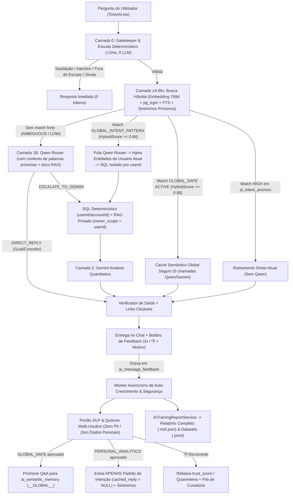
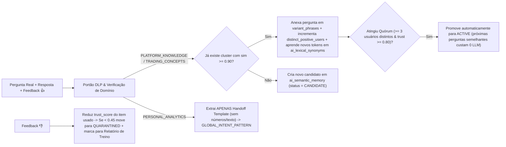

# Plano Arquitetural — Torex AI Auto-Evolutiva, Memória Vetorial por Feedback, Segurança Cross-Tenant & Relatório de Treino (`torexai.md`)

Documento técnico e de engenharia para evoluir a **Torex AI** de um pipeline estático de roteamento + cache volátil em RAM para um sistema **auto-evolutivo, auditável e economizador de LLM**, com:
1. **Feedback estruturado por resposta** (`👍 / 👎` + motivo);
2. **Memória vetorial e associação por palavras mais próximas** (Busca Híbrida: embeddings `gemini-embedding-2` 768d + `pg_trgm` + Full-Text Search + sinónimos aprendidos);
3. **Economia progressiva de chamadas LLM** ao reutilizar conhecimento validado por outros utilizadores **sem jamais expor ou misturar dados pessoais de terceiros**;
4. **Relatório completo e exportação de datasets reais** (`.md`, `.json` e `.jsonl`) para treino, fine-tuning, ajuste de âncoras e avaliação contínua da IA.

> **Alinhamento com o repositório atual:** Este plano estende diretamente a arquitetura existente em [`backend-nest/src/ai/`](file:///e:/TRADING%20COSSA/backend-nest/src/ai/ai.module.ts), [`ai-vector-schema.ts`](file:///e:/TRADING%20COSSA/backend-nest/src/ai/ai-vector-schema.ts), [`TorexAi.tsx`](file:///e:/TRADING%20COSSA/client/src/pages/TorexAi.tsx) e o padrão de regras descrito em [`promptsystem.md`](file:///e:/TRADING%20COSSA/promptsystem.md).

---

## Sumário Executivo

A arquitetura atual já possui uma base sólida (Escudo Determinístico Camada 0, Roteador Semântico Camada 1A com `ai_intent_anchors`, Qwen Router Camada 1B, SQL Determinístico por `userId`, RAG escopado em `ai_rag_chunks` e Analista Gemini Camada 2). Contudo, existem **4 lacunas estratégicas** que impedem a IA de aprender com o uso real e reduzir custos continuamente:

| Lacuna Atual (Observada no Código) | Evidência no Repositório | Impacto Atual | Solução Proposta neste Plano |
| :--- | :--- | :--- | :--- |
| **1. Cache volátil, isolado e literal** | `replyCache` em [`torex-ai-chat.service.ts`](file:///e:/TRADING%20COSSA/backend-nest/src/ai/torex-ai-chat.service.ts#L54-L60) é um `Map` em RAM (600 itens, TTL 30 min, chave `userId::...::normalizedLookup`). | Mudar uma palavra (*"como subo csv"* vs *"onde importo csv"*) ou reiniciar o servidor perde 100% da reutilização e dispara Qwen/Gemini de novo. | **Memória Semântica Persistente (`ai_semantic_memory`)** no PostgreSQL/pgvector com busca híbrida por significado e palavras próximas. |
| **2. Âncoras e sinónimos estáticos** | `SEMANTIC_INTENT_ANCHORS` em [`ai-semantic-intent-router.service.ts`](file:///e:/TRADING%20COSSA/backend-nest/src/ai/ai-semantic-intent-router.service.ts#L60) são hardcoded no deploy. | Expressões reais dos traders, gírias e erros de digitação caem repetidamente em `AMBIGUOUS`/`LOW` (chamando Qwen). | **Tabela `ai_lexical_synonyms` + Clustering Incremental** que relaciona automaticamente novas variações lexicais às intenções e memórias aprovadas. |
| **3. Ausência total de Feedback por resposta** | [`AiChatMessageEntity`](file:///e:/TRADING%20COSSA/backend-nest/src/ai/ai-chat.entity.ts#L78-L102) e [`TorexAi.tsx`](file:///e:/TRADING%20COSSA/client/src/pages/TorexAi.tsx#L1489-L1571) não possuem avaliação do usuário. | Impossível saber quais respostas foram úteis, quais âncoras estão a errar ou quais respostas podem ser reutilizadas sem LLM. | **Botões `👍 / 👎` + motivo estruturado** por mensagem, persistidos em `ai_message_feedback` e ligados ao `trust_score` nos embeddings. |
| **4. Sem relatório nem dataset de treino** | Metadados existem em `ai_chat_messages.metadata`, mas não há consolidação, anonimização nem exportação. | A equipa não tem visibilidade agregada de falhas nem arquivos estruturados para evoluir/treinar modelos ou âncoras. | **`AiTrainingReportService`** gerando relatório completo (`.md`/`.json`) + arquivos `.jsonl` (SFT, DPO, Eval) sanitizados de PII, acessíveis via Painel Admin e CLI. |

---

## 1. Diagnóstico Detalhado da Arquitetura Atual

### 1.1. O que já funciona bem hoje
- **Camada 0 (`AiPromptSystemService` + `AiRouterService`)**: bloqueia saudações, prompt injection, perguntas fora de escopo e pedidos de sinais financeiros em `< 2ms` com `0` chamadas a LLM externo.
- **Camada 1A (`AiSemanticIntentRouterService`)**: calcula embedding `gemini-embedding-2` (768d) e consulta `ai_intent_anchors` via `pgvector` HNSW (com fallback `ai_cosine_similarity_f64`). Quando `confidence === 'HIGH'` (`score >= 0.78` e `margin >= 0.06`), resolve guias da plataforma (`PLATFORM_KNOWLEDGE`) e conceitos (`TRADING_CONCEPTS`) ou monta o `GeminiHandoffSpec` sem chamar o Qwen.
- **Isolamento Multi-Tenant Base (`ai_rag_chunks`)**: [`ai-vector-schema.ts`](file:///e:/TRADING%20COSSA/backend-nest/src/ai/ai-vector-schema.ts#L102) impõe `CHK_ai_rag_chunks_tenant_isolation` garantindo que apenas `PLATFORM_DOC` fica em `__GLOBAL__` e notas pessoais (`DAILY_NOTE`, `TRADE_NOTE`, `GENERAL_NOTE`, `TRADE_LESSON`, `PLAYBOOK`) exigem `owner_scope = user_id`.
- **SQL Determinístico (`AiDeterministicSqlToolsService`)**: calcula métricas reais sempre filtradas por `userId` e `accountId`, sem enviar histórico bruto de trades ao LLM.
- **Telemetria embutida em `AiChatMessageEntity.metadata`**: já guarda `routerDecision`, `routerModel`, `analystModel`, `domainCategory`, `semanticConfidence`, `semanticScore`, `sqlToolsUsed`, `ragSourcesUsed`, `routerLatencyMs`, `analystLatencyMs`, `tokensUsed` e `creditsUsed`.

### 1.2. Limitações que travam o crescimento automático
1. **Conhecimento reutilizável preso ao `user_id` na RAM**: se 500 traders perguntarem *"Qual a diferença entre Profit Factor e Payoff?"* ou *"Como ligar minha conta FTMO via MT5?"*, o sistema executa chamadas semânticas/LLM separadas ou depende de matches rígidos nos tópicos estáticos de [`AiKnowledgeBaseService`](file:///e:/TRADING%20COSSA/backend-nest/src/ai/ai-knowledge-base.service.ts).
2. **Sem fallback lexical para palavras mais próximas**: quando `AiEmbeddingService` fica indisponível (rate limit ou chave inválida) ou o utilizador usa abreviaturas/erros (*"metrader"*, *"puxar historiko"*, *"dd maximo"*), a busca puramente por embeddings não tem auxílio de `pg_trgm` (trigramas) nem dicionário dinâmico de palavras próximas.
3. **Sem ciclo de retroalimentação (Feedback Loop)**: quando o Gemini ou o Qwen acerta uma explicação difícil que antes não estava na base estática, essa boa resposta morre dentro da `ai_chat_sessions` daquele utilizador em vez de fortalecer o sistema (de forma anonimizada, quando segura). E quando erra, o erro continua a repetir-se.

---

## 2. Arquitetura Alvo (Pipeline Auto-Evolutivo e Seguro)



---

## 3. Segurança, Privacidade e Isolamento Cross-Tenant (Requisito Crítico)

Reutilizar aprendizado de perguntas que outros utilizadores já fizeram **NUNCA** pode significar vazar saldo, trades, notas, ativos operados, erros psicológicos ou informações identificáveis de um trader para outro. Para garantir isolamento absoluto (*Defense-in-Depth*), aplicamos **5 barreiras obrigatórias**:

### 3.1. Segregação Estrita por 3 Níveis de Escopo (`scope_level`)

| `scope_level` | `owner_scope` | O que pode armazenar? | `cached_reply` permitido? | Quem pode ler? |
| :--- | :--- | :--- | :---: | :--- |
| **`GLOBAL_SAFE`** | `'__GLOBAL__'` | Perguntas e respostas 100% **gerais**: uso da plataforma (`PLATFORM_KNOWLEDGE`) e conceitos/educação de trading (`TRADING_CONCEPTS`). Ex.: *"Como calculo Expectativa Matemática?"*, *"Onde configuro MT5?"*. | **Sim** (somente após DLP + Quórum/Admin) | Todos os utilizadores (`pt` ou `en` correspondente). |
| **`GLOBAL_INTENT_PATTERN`** | `'__GLOBAL__'` | Apenas o **vetor da pergunta sanitizada** + a **receita estruturada de roteamento** (`subIntent`, `timeframeHint`, `focusMetrics`, flags de RAG/Backtest). Ex.: *"pq perco dinheiro sexta de tarde?"* -> receita `[DIAGNOSTIC_LOSSES, weekday+session matrix]`. | **PROIBIDO (`NULL` forçado por `CHECK` SQL)** | Todos os utilizadores (economiza a etapa do **Qwen Router**; os números vêm 100% do banco do próprio utilizador logado). |
| **`USER_PRIVATE`** | `user_id` | Respostas/preferências/explicações contextualizadas à conta do utilizador (e feedback pessoal dele). | Sim (escopado a `user_id` e `account_id`) | **Exclusivamente** o próprio `user_id` autenticado. |

**Garantia física no PostgreSQL (DDL):**
```sql
CONSTRAINT "CHK_ai_semantic_memory_tenant_safety" CHECK (
    ("scope_level" = 'GLOBAL_SAFE'
        AND "owner_scope" = '__GLOBAL__'
        AND "user_id" IS NULL
        AND "domain_category" IN ('TRADING_CONCEPTS', 'PLATFORM_KNOWLEDGE'))
    OR
    ("scope_level" = 'GLOBAL_INTENT_PATTERN'
        AND "owner_scope" = '__GLOBAL__'
        AND "user_id" IS NULL
        AND "cached_reply" IS NULL)
    OR
    ("scope_level" = 'USER_PRIVATE'
        AND "owner_scope" = "user_id"
        AND "user_id" IS NOT NULL)
)
```
> Mesmo que haja um erro de lógica na aplicação, o banco **recusa fisicamente** gravar uma resposta de `PERSONAL_ANALYTICS` ou texto com `cached_reply` não nulo dentro de `GLOBAL_INTENT_PATTERN`.

### 3.2. Portão DLP & Anonimização (`AiPrivacySanitizerService`)
Antes de qualquer pergunta, sinónimo, resposta ou exemplo entrar em `ai_semantic_memory`, `ai_lexical_synonyms` ou nos arquivos de relatório/treino:
1. **Bloqueio por Domínio e Marcadores Pessoais**:
   - Se `metadata.sqlToolsUsed` não estiver vazio, `metadata.ragSourcesUsed` incluir fontes privadas (`DAILY_NOTE`, `TRADE_NOTE`, `GENERAL_NOTE`, `TRADE_LESSON`, `PLAYBOOK`), ou o texto mencionar métricas de conta/moeda do usuário -> **nunca** pode virar `GLOBAL_SAFE` (no máximo vira `GLOBAL_INTENT_PATTERN` sem texto de resposta e com símbolos/datas convertidos em placeholders como `<SYMBOL>` e `<TIMEFRAME>`).
2. **Scanner de PII e Dados Sensíveis (Regex + Heurística Estrita)**:
   - Detecta e bloqueia/redacta: e-mails, telefones, UUIDs, tokens/API keys, IDs/logins de conta MT5/Deriv (`#123456`, `login 9981`), valores monetários (`$1,240.50`, `USD 450`, `MZN`, `R$`, `EUR`), percentagens associadas a resultado (`win rate de 64.2%`), datas específicas de execução e nomes próprios (`userName` do remetente substituído por `<USER>`).
   - Qualquer candidato `GLOBAL_SAFE` em que o scanner DLP encontre possível dado pessoal é **rejeitado automaticamente** da promoção global.

### 3.3. Proteção Anti-*Vector Poisoning* e Manipulação por Feedback
- **1 usuário != verdade global**: um utilizador sozinho a clicar em `👍` **não** promove nenhuma resposta para o cache global.
- **Regra de Promoção por Quórum (ou Curadoria Admin)**:
  - Uma entrada candidata `GLOBAL_SAFE` só passa de `CANDIDATE` para `ACTIVE` quando cumpre **todos** os critérios:
    1. `distinct_positive_users >= 3` (pelo menos 3 contas/utilizadores distintos deram `👍` no mesmo cluster);
    2. `negative_count === 0` ou taxa de aprovação `>= 85%`;
    3. Passou pelo Portão DLP (`pii_clean = true`) e veio de resposta verificada (`verifyModelOutput` válido, não `support_fallback`);
    4. *Ou* aprovação explícita de um administrador no Painel Admin.
- **Anti-Injection em Notas de Feedback**: o campo opcional `correction_note` enviado pelo usuário nunca entra em `systemPrompt` de outro usuário nem vai direto para `cached_reply`; serve apenas para diagnóstico no relatório admin (também sanitizado contra tags/instruções maliciosas).

### 3.4. Proteção contra Vazamento nas Respostas Cacheadas & Validade Temporal
- **Versionamento de Plataforma (`platform_doc_version`)**: toda memória `GLOBAL_SAFE` sobre rotas ou funcionalidades grava o hash atual de `AiKnowledgeBaseService`. Quando uma rota ou funcionalidade da plataforma mudar (ex.: nova rota em `/backtesting`), memórias antigas são automaticamente invalidadas (`RETIRED`), evitando ensinar menus desatualizados.
- **Desambiguação Pessoal Obrigatória**: se a pergunta atual do usuário contiver possessivos/indicadores pessoais (`"meu"`, `"minha"`, `"meus"`, `"minhas"`, `"my"`, `"minha conta"`, número de conta, saldo), o buscador **bloqueia** match direto em `GLOBAL_SAFE` e permite no máximo match de intenção (`GLOBAL_INTENT_PATTERN`) para rodar o SQL privado do próprio usuário.

---

## 4. Sistema de Feedback por Resposta & UI (`TorexAi`)

### 4.1. Experiência no Frontend ([`TorexAi.tsx`](file:///e:/TRADING%20COSSA/client/src/pages/TorexAi.tsx))
Em cada bolha de resposta do assistente (`msg.role === 'assistant'`), exceto durante a digitação progressiva (`isCurrentlyTyping`) e mensagens de erro/suporte (`support_fallback`):
- Exibir barra discreta no rodapé da bolha (seguindo tokens `text-fg-subtle`, `border-line`, `bg-surface-2`, `text-accent-fg`):
  - Botão **Copiar** (`Copy` / `Check`)
  - Botão **👍 Útil** (`ThumbsUp`)
  - Botão **👎 Precisa melhorar** (`ThumbsDown`)
  - Badge discreto quando houver reutilização de conhecimento (sem expor jargão interno — ex.: apenas tooltip opcional ou manter limpo no padrão atual).
- **Fluxo ao clicar `👍`**:
  - Dispara `POST /api/ai/chat/messages/:messageId/feedback` com `{ rating: 1 }`.
  - Estado visual imediato (optimistic update): ícone `ThumbsUp` destacado em `text-accent-fg` + micro-confirmação sutil *"Feedback guardado"*.
- **Fluxo ao clicar `👎`**:
  - Marca `rating: -1` imediatamente e abre um **mini-card inline compacto** logo abaixo da bolha com chips de 1 clique (PT/EN via `useLocale()`):
    - `INACCURATE` — *"Dados ou regra incorreta"* / *"Inaccurate data or rule"*
    - `WRONG_INTENT` — *"Não entendeu minha pergunta"* / *"Misunderstood my question"*
    - `GENERIC` — *"Resposta muito genérica"* / *"Too generic"*
    - `INCOMPLETE` — *"Faltou detalhe ou passo seguinte"* / *"Missing details or next steps"*
  - Input opcional enxuto (`maxLength={240}`): *"Como poderíamos melhorar esta resposta? (opcional)"* + botão **Enviar** / **Fechar**.
- Clicar novamente no mesmo ícone envia `DELETE /api/ai/chat/messages/:messageId/feedback` (permite alternar ou desfazer).

### 4.2. Contrato de API Backend ([`AiController`](file:///e:/TRADING%20COSSA/backend-nest/src/ai/ai.controller.ts))
- **`POST /api/ai/chat/messages/:messageId/feedback`** (`@UseGuards(JwtAuthGuard)`):
  - Valida DTO:
    - `rating`: `1 | -1`
    - `reasonCode?`: `'INACCURATE' | 'WRONG_INTENT' | 'GENERIC' | 'INCOMPLETE' | 'OTHER'`
    - `correctionNote?`: string sanitizada (máx. 240 chars)
  - Verifica posse estrita: `message -> session.userId === req.user.id` e `message.role === 'assistant'`.
  - Faz `UPSERT` idempotente por `(message_id, user_id)` em `ai_message_feedback`.
  - Atualiza `metadata.userFeedback` na mensagem para retorno imediato ao recarregar histórico (`GET /ai/chat/sessions/:id`).
  - Publica evento assíncrono (`ai.feedback.recorded`) para a fila/worker de aprendizagem atualizar `trust_score`, `ai_lexical_synonyms` e candidatos em `ai_semantic_memory` sem bloquear a resposta HTTP.
- **`DELETE /api/ai/chat/messages/:messageId/feedback`**:
  - Remove o feedback do utilizador autenticado para aquela mensagem e reajusta contadores.

---

## 5. Modelo de Dados & Busca Híbrida ("Salvar nos Embeddings e Relacionar com Palavras Mais Próximas")

### 5.1. Novas Tabelas PostgreSQL (Migration `1779...`)

1. **`ai_message_feedback`**
   - `id` (`uuid PK`), `message_id` (`uuid NOT NULL`), `session_id` (`uuid NOT NULL`), `user_id` (`varchar NOT NULL`)
   - `rating` (`smallint CHECK (rating IN (-1, 1))`)
   - `reason_code` (`varchar(32) NULL`)
   - `correction_note` (`varchar(280) NULL` — higienizada)
   - `locale` (`varchar(8)`), `domain_category` (`varchar(40)`), `intent` (`varchar(80)`), `router_decision` (`varchar(40)`), `router_model` (`varchar(80)`), `analyst_model` (`varchar(80)`)
   - `semantic_memory_id` (`uuid NULL` — caso a resposta tenha vindo de um hit de `ai_semantic_memory`, fecha o ciclo direto de reputação)
   - `matched_anchor_key` (`varchar(120) NULL`)
   - `normalized_question` (`text NOT NULL`)
   - `created_at`, `updated_at`
   - Constraint `UQ_ai_message_feedback_msg_user UNIQUE (message_id, user_id)`.

2. **`ai_semantic_memory`** (Base Vetorial + Lexical Auto-Evolutiva)
   - `id` (`uuid PK`)
   - `scope_level` (`'GLOBAL_SAFE' | 'GLOBAL_INTENT_PATTERN' | 'USER_PRIVATE'`)
   - `owner_scope` (`varchar(64)` — `'__GLOBAL__'` ou `user_id`), `user_id` (`varchar(64) NULL`), `account_id` (`varchar(64) NULL`)
   - `locale` (`varchar(8)`), `domain_category` (`varchar(40)`), `sub_intent` (`varchar(60) NULL`), `intent_key` (`varchar(120)`)
   - `canonical_question` (`text NOT NULL` — anonimizada se global)
   - `normalized_question` (`text NOT NULL`)
   - `variant_phrases` (`jsonb DEFAULT '[]'` — até 25 formulações reais próximas que bateram nesse mesmo significado)
   - `keywords_tsvector` (`tsvector` indexado com GIN para busca lexical rápida)
   - `embedding_model` (`varchar(80)` = `'gemini-embedding-2'`), `dimensions` (`int` = `768`)
   - `embedding_f64` (`double precision[] NOT NULL`), `embedding_vector` (`vector(768) NULL` + HNSW quando `pgvector` estiver ativo)
   - `cached_reply` (`text NULL` — obrigatório `NULL` em `GLOBAL_INTENT_PATTERN`)
   - `handoff_template` (`jsonb NULL` — usado para `GLOBAL_INTENT_PATTERN`)
   - `actions` (`jsonb DEFAULT '[]'`), `suggestions` (`jsonb DEFAULT '[]'`)
   - `status` (`'CANDIDATE' | 'ACTIVE' | 'QUARANTINED' | 'RETIRED'`)
   - `positive_count`, `negative_count`, `distinct_positive_users`, `hit_count`, `llm_tokens_saved`
   - `trust_score` (`double precision DEFAULT 0.5`)
   - `platform_doc_version` (`varchar(64) NULL`)
   - `last_hit_at`, `created_at`, `updated_at`.

3. **`ai_lexical_synonyms`** (Rede de Palavras Mais Próximas & Vocabulário Real de Traders)
   - `id` (`uuid PK`)
   - `surface_term` (`varchar(120)` — ex.: `"subir planilha"`, `"metrader"`, `"revenge"`, `"stop loss apertado"`, `"ouro"`)
   - `canonical_term` (`varchar(120)` — ex.: `"importar trades csv"`, `"mt5"`, `"overtrading emocional"`, `"stop curto"`, `"XAUUSD"`)
   - `intent_key` (`varchar(120) NULL`), `domain_category` (`varchar(40)`), `locale` (`varchar(8)`)
   - `embedding_f64` (`double precision[] NULL`), `embedding_vector` (`vector(768) NULL`)
   - `co_occurrence_count` (`int DEFAULT 1`), `positive_weight` (`double precision DEFAULT 1.0`), `is_active` (`boolean DEFAULT true`)
   - Índice `GIN (surface_term gin_trgm_ops)` usando extensão nativa PostgreSQL **`pg_trgm`** (com fallback automático caso não esteja habilitada).

### 5.2. Como Funciona o Relacionamento com "Palavras Mais Próximas" (Busca Híbrida + Expansão)

Quando chega uma nova pergunta $q$ do usuário (ex.: *"onde puxo meu historico do metrader?"* ou *"to tomando muito stop no ouro de tarde"*):

1. **Normalização & Expansão Lexical via `ai_lexical_synonyms`**:
   - O normalizador extrai tokens/n-gramas de $q$, consulta sinónimos próximos com similaridade trigram (`similarity(surface_term, token) >= 0.55` em `pg_trgm`) ou match vetorial próximo, e expande internamente a consulta de busca:
     - `"metrader"` -> associa a `"mt5 metatrader"` (`import_trades`)
     - `"puxo historico"` -> associa a `"importar trades sincronizar"`
     - `"ouro"` -> associa a `"XAUUSD"`
   - Essa query enriquecida gera **melhor precisão** mesmo em prompts curtos do plano `BASIC` (50 chars!).

2. **Ranqueamento Híbrido em 3 Sinais (`HybridScore`)**:
   Para cada candidato elegível em `ai_semantic_memory` (`status = 'ACTIVE'` e `owner_scope IN ('__GLOBAL__', :userId)`):
   - **Sinal 1 — Similaridade Vetorial Densa ($S_{\text{vec}} \in [0,1]$)**: cosseno no `gemini-embedding-2` (768d) entre a pergunta atual e `canonical_question` (captura equivalência semântica profunda).
   - **Sinal 2 — Proximidade Lexical / Palavras Próximas ($S_{\text{lex}} \in [0,1]$)**: combinação de `pg_trgm` (`similarity(normalized_question, q_norm)`) + PostgreSQL Full-Text (`ts_rank_cd(keywords_tsvector, plainto_tsquery(...))`), garantindo resiliência a **typos**, radicais próximos e até quando a API externa de embeddings estiver temporariamente indisponível!
   - **Sinal 3 — Reputação por Feedback ($S_{\text{trust}} \in [0,1]$)**: calculado com suavização de Wilson / Bayesiana sobre `positive_count` vs `negative_count` + decaimento de antiguidade.

   Fórmula composta:
   ```text
   HybridScore = 0.65 * S_vec + 0.20 * S_lex + 0.15 * S_trust
   ```
   *(Se o motor de embeddings estiver offline, degrada automaticamente para `0.75 * S_lex + 0.25 * S_trust` apenas com threshold conservador, garantindo continuidade sem custo externo.)*

3. **Ação por Faixa de Confiança**:
   - **`HybridScore >= 0.88` + `scope_level = 'GLOBAL_SAFE'` + sem sinal de pergunta pessoal**:
     -> **Cache Semântico Hit Direto**: retorna `cached_reply` (validada pelo `verifyModelOutput` + `resolveRouteActionsFromText`), `0` chamadas ao Qwen, `0` chamadas ao Gemini, atualiza `hit_count += 1` e registra economia em `llm_tokens_saved`.
   - **`HybridScore >= 0.84` + `scope_level = 'GLOBAL_INTENT_PATTERN'`**:
     -> **Atalho de Intenção**: pula o Qwen Router (`0` chamadas ao Qwen), preenche `GeminiHandoffSpec` com os símbolos/período da pergunta **do usuário atual**, roda `AiDeterministicSqlToolsService` e `AiRagService` isolados por `userId` e chama apenas o Gemini (ou compositor determinístico).
   - **`HybridScore entre 0.72 e 0.87`**:
     -> Passa os **2 melhores padrões/sinónimos próximos** como *few-shot hint* para o Qwen Router, aumentando precisão e reduzindo tokens de contexto.

### 5.3. Como o Modelo Cresce Automaticamente (Loop Contínuo)



**Benefícios diretos com o tempo:**
- Mês 1: maior parte das variações de perguntas novas ainda aciona Qwen/Gemini e recebe feedbacks `👍 / 👎`.
- Mês 2+: o grafo de `ai_semantic_memory` + `ai_lexical_synonyms` absorve centenas de formas diferentes que os utilizadores usam para perguntar as mesmas coisas (com gírias, typos e sinónimos de trading), **derrubando progressivamente o percentual de requisições que precisam ir ao Qwen/Gemini** — tanto em dúvidas gerais (`0` LLM) quanto em perguntas analíticas (`0` Qwen Router).

---

## 6. Arquivo e Relatório Completo de Dados para Treinar a IA (`AiTrainingReportService`)

O utilizador pediu explicitamente: *"devemos ter um arquivo com relatório completo de dados para treinar a ai"*. Vamos implementar uma arquitetura de relatórios e exportação em **dois formatos sincronizados**:

### 6.1. O que contém o Relatório Completo (`torexai-training-report.md` / `.json`)

Gerado sob demanda via Admin API ou CLI e agendado semanalmente (`@Cron`), contendo **7 secções estruturadas**:

1. **Sumário Executivo de Desempenho & Economia**:
   - Total de interações no período (`total_messages`, sessões únicas, distribuição `pt` vs `en`, distribuição por plano `BASIC`/`PRO`/`PREMIUM`).
   - Breakdown exato por caminho de execução:
     - `% Camada 0 (Escudo/Saudações — 0 LLM)`
     - `% Hit em Memória Semântica Global (0 LLM)`
     - `% Atalho Semântico/Padrão sem Qwen`
     - `% Qwen Router + Gemini Analista`
     - `% Fallback / Erro de provedor`
   - **Tokens e Custo Economizados**: `llm_calls_avoided`, `llm_tokens_saved`, latência P50/P95 por camada (`routerLatencyMs`, `analystLatencyMs`).
2. **Qualidade Percebida (Telemetria de Feedback `👍 / 👎`)**:
   - Taxa global de aprovação (`thumbs_up / total_rated`).
   - Aprovação por `domain_category`, por `sub_intent`, por `router_model` e por `analyst_model` (`gemini-3.8-flash` vs `gemini-3.1-flash-lite` vs `qwen`).
   - Distribuição de motivos de erro (`INACCURATE`, `WRONG_INTENT`, `GENERIC`, `INCOMPLETE`).
3. **Clusters de Falha & Pontos Cegos ("Onde treinar primeiro")**:
   - Top perguntas com `semanticConfidence = 'LOW'` ou `'AMBIGUOUS'` agrupadas por cluster semântico.
   - Top perguntas/intencionalidades com `👎` recorrente (com exemplo de pergunta anonimizada, decisão tomada pelo router e motivo do utilizador).
   - Sugestões automáticas de novas âncoras para adicionar em `SEMANTIC_INTENT_ANCHORS` ou novos tópicos para `AiKnowledgeBaseService`.
4. **Evolução da Memória Semântica & Palavras Próximas**:
   - Contagem de itens em `CANDIDATE`, `ACTIVE`, `QUARANTINED`, `RETIRED`.
   - Top 25 respostas mais reutilizadas e quanto economizaram.
   - Top 50 associações de palavras próximas descobertas (`surface_term -> canonical_term`) com contagem de acertos.
5. **Auditoria de Segurança & Guardrails**:
   - Quantidade de tentativas bloqueadas de prompt injection / pedido de sinal / vazamento cross-tenant.
   - Quantidade de candidatos barrados pelo Portão DLP antes de entrar no pool global (garantia de `0` PII exportado).
6. **Estatísticas dos Datasets de Treino Gerados**:
   - Contagem de linhas limpas exportadas em cada split (`router_sft`, `rag_qa`, `dpo_preference`, `eval_golden`).
7. **Plano de Ação Recomendado Automático**:
   - Lista priorizada por impacto (ex.: *"Adicionar tópico sobre regras de drawdown Prop Firm: 47 perguntas no último mês com 38% de 👎"*).

### 6.2. Arquivos de Dataset para Treino, Fine-Tuning e Avaliação (`*.jsonl`)

Todos os registros exportados passam obrigatoriamente pelo **Portão DLP (`AiPrivacySanitizerService`)** antes de serem escritos no arquivo, removendo `user_id`, `account_id`, e-mails, valores financeiros reais e notas privadas:

| Arquivo Exportável | Uso Direto em Treino / IA | Estrutura de Cada Linha JSONL | Critério de Inclusão |
| :--- | :--- | :--- | :--- |
| **`dataset_router_sft.jsonl`** | Fine-tuning / destilação do roteador leve (Qwen ou classificador local) | `{"messages":[{"role":"system","content":"..."},{"role":"user","content":"<sanitized_q>"},{"role":"assistant","content":"{\"decision\":...,\"domainCategory\":...,\"subIntent\":...,\"focusMetrics\":...}"}], "meta":{"locale":"pt","confidence":0.91}}` | Apenas interações com `👍` (ou `HIGH` sem `👎`) e zero PII. |
| **`dataset_rag_qa_approved.jsonl`** | Treino de respostas de suporte/educação + expansão de base vetorial | `{"instruction":"<sanitized_q>","domain":"PLATFORM_KNOWLEDGE|TRADING_CONCEPTS","response":"<verified_reply>","locale":"pt","trust_score":0.94,"distinct_users":5}` | Apenas `GLOBAL_SAFE` com `👍`, nunca `PERSONAL_ANALYTICS`. |
| **`dataset_dpo_preference.jsonl`** | Alinhamento por preferência (DPO) e análise de erros | `{"prompt":"<sanitized_q>","chosen":"<approved_reply_same_intent>","rejected":"<downvoted_reply>","reason_code":"GENERIC|WRONG_INTENT"}` | Clusters onde há contraste real entre resposta bem avaliada e mal avaliada (sem dados privados). |
| **`dataset_eval_benchmark.jsonl`** | Suite automática de regressão antes de trocar modelos/prompts | `{"id":"...","question":"<sanitized_q>","expected_domain":"...","expected_sub_intent":"...","must_not_leak_pii":true}` | Amostra estratificada dos 3 domínios + casos adversariais de segurança. |

### 6.3. Onde o Arquivo é Gerado e Consultado

1. **Endpoints Admin Protegidos** (em [`AdminController`](file:///e:/TRADING%20COSSA/backend-nest/src/admin/admin.controller.ts) com `@UseGuards(AdminAuthGuard)`):
   - `GET /api/admin/ai/training-report?from=...&to=...` — retorna JSON completo para visualização no Painel Admin ([`AdminAnalytics.tsx`](file:///e:/TRADING%20COSSA/client/src/pages/admin/AdminAnalytics.tsx) ou sub-aba dedicada *Torex AI Training & Memory*).
   - `GET /api/admin/ai/training-report/export?format=markdown|json|sft_jsonl|rag_qa_jsonl|dpo_jsonl|eval_jsonl&from=...&to=...` — gera e faz download direto do arquivo completo com cabeçalhos `Content-Disposition: attachment` e registo de auditoria.
   - `GET /api/admin/ai/semantic-memory` e `POST /api/admin/ai/semantic-memory/:id/review` (`APPROVE | QUARANTINE | RETIRE`) — fila de curadoria humana para memórias candidatas ou quarentenadas.
2. **Script CLI & Geração em Disco no Servidor (`backend-nest/src/scripts/export-ai-training-report.ts`)**:
   - Comando `npm run ai:training-report` que gera o relatório completo em pasta ignorada pelo Git (ex.: `backend-nest/reports/ai-training/YYYY-MM-DD/REPORT.md` + arquivos `.jsonl`), garantindo que **nunca** sejam commitados logs ou conversas no repositório.

---

## 7. Plano de Implementação por Fases

### Fase 0 — Schema, Telemetria & Sistema de Feedback por Resposta (P0)
- **Backend**:
  - Criar migration `backend-nest/src/migrations/1779000000000-AiFeedbackAndSemanticMemory.ts` criando `ai_message_feedback`, `ai_semantic_memory`, `ai_lexical_synonyms`, índices `pgvector` HNSW e índice trigram `pg_trgm` (com fallback limpo caso a extensão não esteja instalada).
  - Criar entidades TypeORM e DTOs validados em `backend-nest/src/ai/`.
  - Adicionar endpoints `POST /api/ai/chat/messages/:messageId/feedback` e `DELETE /api/ai/chat/messages/:messageId/feedback` em [`AiController`](file:///e:/TRADING%20COSSA/backend-nest/src/ai/ai.controller.ts).
  - Padronizar gravação de `metadata.semanticMemoryId` e `metadata.cacheOrigin` em [`TorexAiChatService`](file:///e:/TRADING%20COSSA/backend-nest/src/ai/torex-ai-chat.service.ts).
- **Frontend**:
  - Atualizar `ClientAiMessage` em [`torexAiFallback.ts`](file:///e:/TRADING%20COSSA/client/src/components/ai/torexAiFallback.ts) para incluir `userFeedback`.
  - Adicionar botões `👍`, `👎`, motivo rápido de 1 clique e campo opcional de melhoria na bolha do assistente em [`TorexAi.tsx`](file:///e:/TRADING%20COSSA/client/src/pages/TorexAi.tsx).

### Fase 1 — Guardião DLP & Busca Híbrida Auto-Evolutiva (Embeddings + Palavras Próximas) (P0/P1)
- **Backend**:
  - Criar `AiPrivacySanitizerService` (regras de bloqueio de `PERSONAL_ANALYTICS`, scanner de PII/tokens/números de conta/PnL e placeholders `<SYMBOL>` / `<TIMEFRAME>`).
  - Criar `AiSemanticMemoryService` implementando:
    - Expansão por `ai_lexical_synonyms` (`pg_trgm` + exato);
    - Busca híbrida (`0.65 * Vector + 0.20 * Lexical(pg_trgm/FTS) + 0.15 * TrustScore`);
    - Consulta estrita por escopo (`GLOBAL_SAFE` vs `GLOBAL_INTENT_PATTERN` vs `USER_PRIVATE`).
  - Integrar **Camada 1A-Bis** em [`AiRouterService.routeUserMessage`](file:///e:/TRADING%20COSSA/backend-nest/src/ai/ai-router.service.ts#L200) para responder diretamente hits `GLOBAL_SAFE` (`0` LLM) e atalhar o Qwen em hits `GLOBAL_INTENT_PATTERN`.

### Fase 2 — Pipeline de Crescimento Automático & Reputação por Quórum (P1)
- **Backend**:
  - Criar `AiAutoLearningService` (processamento assíncrono por evento/cron):
    - Processa eventos `👍`: sanitiza via DLP, busca cluster existente (`sim >= 0.90`), cria `CANDIDATE` ou atualiza `variant_phrases` + `distinct_positive_users` + `ai_lexical_synonyms`.
    - Promove `CANDIDATE -> ACTIVE` somente após quórum seguro (`>= 3` utilizadores distintos, `trust_score >= 0.80`) ou aprovação Admin.
    - Processa eventos `👎`: reduz `trust_score`, coloca itens degradados em `QUARANTINED` e registra no mapa de pontos cegos.
    - Invalida automaticamente entradas `GLOBAL_SAFE` antigas quando `platform_doc_version` de [`AiKnowledgeBaseService`](file:///e:/TRADING%20COSSA/backend-nest/src/ai/ai-knowledge-base.service.ts) mudar.

### Fase 3 — Relatório Completo de Treino, Exportador `.jsonl`/`.md` & Curadoria Admin (P1/P2)
- **Backend**:
  - Criar `AiTrainingReportService` com agregação SQL de métricas de roteamento, economia de LLM, satisfação `👍 / 👎`, clusters semânticos com baixa confiança/erro, termos próximos descobertos e gerador dos 4 splits `.jsonl` livres de PII.
  - Expor rotas administrativas sob `@UseGuards(AdminAuthGuard)` em [`AdminController`](file:///e:/TRADING%20COSSA/backend-nest/src/admin/admin.controller.ts) e adicionar métricas no `GET /api/admin/system-overview`.
  - Criar script CLI `backend-nest/src/scripts/export-ai-training-report.ts`.
- **Frontend (Painel Admin)**:
  - Adicionar secção/aba **"Torex AI — Treino, Feedback & Memória"** em [`AdminAnalytics.tsx`](file:///e:/TRADING%20COSSA/client/src/pages/admin/AdminAnalytics.tsx) com KPIs de economia de LLM, taxa de `👍/👎`, botão de download direto do Relatório Completo (`.md`/`.json`) e datasets (`.jsonl`), e fila de aprovação/quarentena para `ai_semantic_memory`.

### Fase 4 — Testes Automatizados, Segurança Adversarial & Benchmark (P2)
- Criar suite `backend-nest/src/ai/ai-phase6-learning-security.spec.ts` cobrindo obrigatoriamente:
  1. **Isolamento Cross-Tenant**: simular Usuário A perguntando sobre seu PnL/trades no `XAUUSD` e dando `👍`; verificar no banco que `cached_reply` **não** existe no pool global, e que Usuário B perguntando parecido recebe receita `GLOBAL_INTENT_PATTERN` aplicada **exclusivamente** aos trades de Usuário B.
  2. **DLP / Bloqueio de PII**: tentar promover uma resposta contendo e-mail, `#88412`, `$1,540.00` ou `win rate pessoal` para `GLOBAL_SAFE` e confirmar bloqueio.
  3. **Anti-Poisoning**: 1 utilizador dando `👍` repetido (ou tentando manipular `correctionNote` com prompt injection) **não** promove item para `ACTIVE` global.
  4. **Busca Híbrida + Palavras Próximas**: perguntas com erros ortográficos (`"metrader"`, `"backetest"`) ou sinónimos (`"ouro"`, `"puxar trades"`) resolvem por `ai_semantic_memory` / `ai_lexical_synonyms` com `0` chamadas ao Qwen/Gemini.
  5. **Quarentena Automática por `👎`**: múltiplos `👎` derrubam `trust_score` e movem o item para `QUARANTINED`, retirando-o de hits futuros.
  6. **Auditoria do Arquivo de Relatório & JSONL**: confirmar que o arquivo `.md` e os `.jsonl` gerados por `AiTrainingReportService` contêm métricas e exemplos válidos sem nenhum `userId`, email, token ou valor financeiro privado.

---

## 8. Critérios de Sucesso (KPIs Alvo após Implantação)

| Métrica | Linha de Base Atual | Meta Pós-Fase 3 |
| :--- | :---: | :---: |
| **% de perguntas gerais/plataforma resolvidas com `0` LLM** | Apenas hits literais na RAM (`30 min`) ou âncoras estáticas | **>= 70%** após acúmulo inicial de feedback |
| **% de perguntas analíticas que pulam Qwen Router via `GLOBAL_INTENT_PATTERN`** | Apenas âncoras estáticas `HIGH` | **>= 60%** com expansão automática por sinónimos |
| **Vazamentos de dados pessoais entre usuários (`Cross-Tenant Leaks`)** | `0` (garantido) | **`0` (invariante absoluta verificada por DDL + DLP + Testes)** |
| **Visibilidade para treino e melhoria** | Sem relatório nem feedback | **100% das respostas avaliáveis** + relatório semanal/sob demanda + datasets `.jsonl` prontos |
